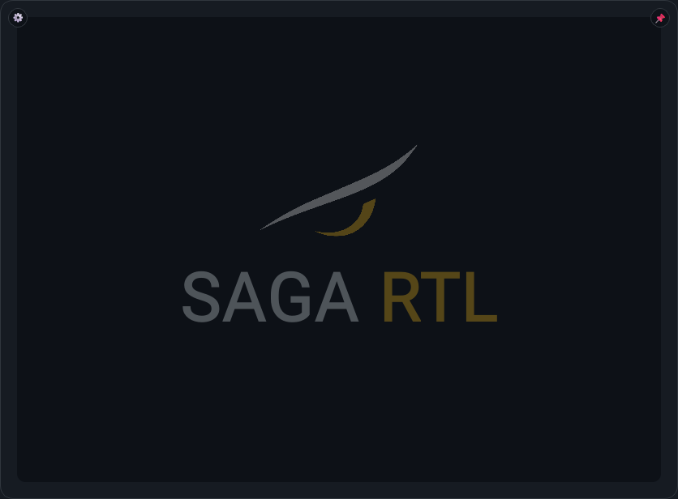
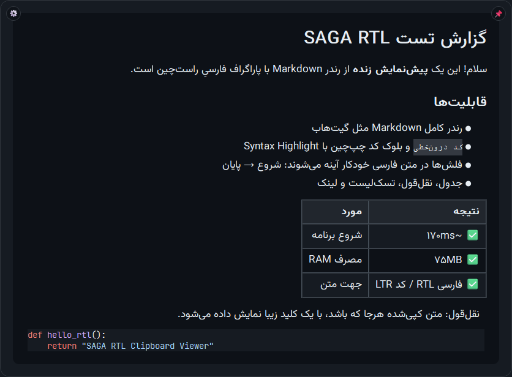

# SAGA RTL — Clipboard Viewer (ویندوز)

برنامه‌ای سبک برای نمایش محتوای کلیپ‌بورد به‌صورت **Markdown رندرشده، راست‌چین و تیره** — با یک میانبر سراسری.

کلید `→` (جهت راست) را بزنید: متنِ کلیپ‌بورد در یک پاپ‌آپ شیک در مرکز صفحه ظاهر می‌شود؛ متن فارسی راست‌چین است، متن انگلیسی و بلوک‌های کد همیشه چپ‌چین می‌مانند و کدها Syntax Highlight می‌شوند.

   

| صفحهٔ خوش‌آمد | رندر محتوا |
|---|---|
|  |  |

## 🇬🇧 English

**SAGA RTL Clipboard Viewer** — a lightweight Windows popup that renders your clipboard as GitHub-styled Markdown with first-class RTL support. Press the `→` hotkey: Persian text renders right-aligned, English text and code blocks stay left-aligned, code gets Pygments syntax highlighting. Fully dark (GitHub Dark), frameless popup with fade animation, search, zoom, middle-click autoscroll, pin, right-click lock, configurable hotkey and autostart. Python 3.12+, PySide6, no WebEngine. MIT licensed.

```bat
run.bat     :: setup venv + run (first run installs dependencies)
build.bat   :: build a single-file RTLViewer.exe with PyInstaller
```

---

## ✨ امکانات

- 🌐 **میانبر سراسری**: کلید `→` (جهت راست) برای باز/بسته کردن پاپ‌آپ از داخل هر برنامه‌ای (از تنظیمات قابل تغییر)
- 🔤 **RTL هوشمند**: هر بلاک متنی (پاراگراف، تیتر، آیتم لیست، سلول جدول، نقل‌قول) بر اساس محتوایش جهت می‌گیرد
- ↔️ **آینه‌شدن فلش‌ها در متن فارسی**: در هر بلاک راست‌به‌چپ همهٔ فلش‌های `→ ← ⇒ ⇐` (حتی بین کلمات انگلیسی یا داخل کد درون‌خطی) یکدست معکوس می‌شوند تا جهت جریان متن درست دیده شود؛ بلوک‌های کد و پاراگراف‌های کاملاً انگلیسی دست‌نخورده می‌مانند
- 💻 **کد همیشه LTR**: بلوک‌های کد و کد درون‌خطی هرگز راست‌چین نمی‌شوند
- 📝 **رندر کامل Markdown** مانند GitHub: تیتر، بولد، ایتالیک، خط‌خورده، لیست، تسک‌لیست، جدول، نقل‌قول، کدبلاک، خط افقی، لینک و تصویر (شامل تصاویر اینترنتی که به‌صورت غیرهمزمان دانلود می‌شوند)
- 🎨 **Syntax Highlight** با پالت GitHub Dark (Pygments)
- 🔍 **جستجوی درون‌متنی** با هایلایت همه نتایج
- 🔎 **زوم** با `Ctrl + چرخ ماوس` (بین ۰.۵ تا ۲.۵ برابر)
- 🖱️ **اسکرول خودکار مرورگری**: کلیک وسط ماوس → نشانگر جهت‌نما ظاهر می‌شود → هر جهتی ماوس را بکشید، سند به همان جهت (عمودی و افقی) با سرعت متناسب با فاصله اسکرول می‌شود؛ هر کلیک، `Esc` یا چرخ ماوس آن را متوقف می‌کند
- 🖼 پنجره بدون حاشیه با گوشه‌های گرد ۱۶px، سایه نرم، همیشه بالای همه پنجره‌ها
- 🚀 باز شدن با انیمیشن Fade در ۱۸۰ میلی‌ثانیه
- 🧲 نمایش **بدون دزدیدن فوکوس** از برنامه فعال (`WS_EX_NOACTIVATE`)؛ با کلیک روی پنجره، فوکوس گرفته می‌شود
- 📋 تشخیص خودکار نوع محتوا: Markdown / کد / متن ساده

## ⌨️ میانبرها

| میانبر | عملکرد |
|---|---|
| `→` (کلید جهت راست) | باز / بسته کردن پاپ‌آپ (سراسری — از تنظیمات قابل تغییر) |
| `Esc` | بستن پاپ‌آپ (سراسری، فقط وقتی پاپ‌آپ باز است) |
| **کلیک خارج از پنجره** | بستن پاپ‌آپ (قابل غیرفعال‌سازی از settings.json) |
| **کلیک وسط (قرقره) + حرکت ماوس** | اسکرول خودکار در هر جهت، مثل مرورگرها — با هر کلیک، `Esc` یا چرخ ماوس متوقف می‌شود |
| **کشیدن از حاشیه‌ها** | جابه‌جایی پنجره — کلیک روی نواحی خالی اطراف محتوا و کشیدن؛ موقعیت جدید ذخیره می‌شود و دفعه بعد همان‌جا باز می‌شود |
| `Ctrl + چرخ ماوس` | بزرگ/کوچک کردن فونت |
| `Ctrl + C` | کپی متن انتخاب‌شده |
| `Ctrl + Shift + C` | کپی کل متن خام Clipboard |
| `Ctrl + F` | جستجو در متن (`Enter` نتیجه بعدی، `Shift+Enter` قبلی، `Esc` بستن جستجو) |
| `F11` | حالت تمام‌صفحه |

> 💡 چون پاپ‌آپ فوکوس برنامه فعال را نمی‌دزدد، برای استفاده از میانبرهای داخل پنجره (`Ctrl+F`، `Ctrl+C` و…) ابتدا یک‌بار روی پنجره کلیک کنید. `Esc` و میانبر اصلی بدون کلیک هم کار می‌کنند.

## 🚀 نصب و اجرا

پیش‌نیاز: **Python 3.12+** روی ویندوز

**ساده‌ترین راه — دابل کلیک:**

```bat
run.bat
```

بار اول (اگر `.venv` وجود نداشته باشد) خودش محیط را می‌سازد و وابستگی‌ها را نصب می‌کند؛ بعد برنامه را **بدون پنجره کنسول** اجرا می‌کند.

**راه دستی:**

```bat
pip install -r requirements.txt
python main.py
```

برنامه در پس‌زمینه می‌ماند و با کلید `→` (جهت راست) فراخوانی می‌شود. خروج از برنامه از آیکون کنار ساعت (System Tray) → «خروج».

### وابستگی‌ها

| بسته | کاربرد |
|---|---|
| `PySide6` | رابط کاربری (QTextBrowser سبک و کم‌مصرف به‌جای WebEngine) |
| `markdown-it-py` | پارسر Markdown سازگار با GFM (جدول، خط‌خورده، لینک‌سازی خودکار، تسک‌لیست) |
| `Pygments` | هایلایت کد با رنگ‌های GitHub Dark |
| `keyboard` | میانبر سراسری (هوک سطح‌پایین ویندوز؛ نیازی به دسترسی ادمین ندارد) |
| `pyperclip` | خواندن/نوشتن کلیپ‌بورد |

> نکته: در فهرست اولیه، بسته `pyqtdarktheme` هم دیده می‌شد؛ این بسته پایتون ۳.۱۲ به بعد را پشتیبانی نمی‌کند، بنابراین تم تیره با QSS اختصاصی و پالت GitHub Dark پیاده‌سازی شده است.

## 📦 ساخت نسخه اجرایی (exe)

```bat
build.bat
```

خروجی: `dist\RTLViewer.exe` (تک‌فایل، بدون کنسول، همراه با فونت‌ها).

- اجرای `build.bat` خودش وابستگی‌ها + PyInstaller را نصب می‌کند.
- ساخت `--onefile` است؛ اجرای اول کمی کندتر است (خوداستخراج). برای استارت سریع‌تر می‌توانید در فایل، پرچم `--onefile` را به `--onedir` تغییر دهید.
- برای اجرای بدون نصب، Python لازم نیست؛ فقط فایل exe کافی است.

## 🗂 ساختار پروژه

```
rtl_viewer/
├── main.py               # نقطه ورود: فونت‌ها، تم، سیم‌کشی اجزا، آیکون Tray
├── window.py             # پاپ‌آپ: انیمیشن، جستجو، زوم، اسکرول نرم، رفتارهای ویندوزی
├── clipboard.py          # سرویس کلیپ‌بورد (pyperclip + تلاش مجدد)
├── markdown_renderer.py  # تشخیص نوع محتوا + رندر MD/کد/متن با RTL/LTR درست
├── hotkeys.py            # میانبر سراسری قابل‌تنظیم + ضبط میانبر + پل امن نخ کیبورد به Qt
├── settings.py           # تنظیمات پایدار (JSON در %APPDATA%\RTLViewer)
├── settings_dialog.py    # دیالوگ تنظیمات (تغییر میانبر، فونت، رفتار بسته‌شدن)
├── resources/
│   ├── Vazirmatn-Regular.ttf      # فونت متن فارسی
│   └── JetBrainsMono-Regular.ttf  # فونت کد
├── build.bat             # ساخت exe با PyInstaller
└── requirements.txt
```

## ⚙️ تنظیمات

### از داخل برنامه (پیشنهادی)

روی آیکون برنامه کنار ساعت راست‌کلیک کنید → **تنظیمات…**:

- **میانبر باز/بسته کردن**: دکمه را بزنید و کلید ترکیبی دلخواه را فشار دهید — ترتیب مهم نیست، تک‌کلید (مثل `Right` یا `F9`)، کوردهای تغییردهنده (مثل `Ctrl+Win+Alt+Right`) و کلیدهای جهت (Right/Left/Up/Down) پشتیبانی می‌شوند؛ `Esc` = انصراف.
- **بستن پنجره با کلیک بیرون**: روشن/خاموش
- **اجرای خودکار با روشن شدن ویندوز**: با فعال‌کردن، برنامه در ورود به ویندوز به‌صورت خودکار در پس‌زمینه اجرا می‌شود (کلید رجیستری کاربر `HKCU\…\Run` — بدون نیاز به دسترسی مدیر). در حالت سورس با `pythonw` و بدون پنجرهٔ کنسول اجرا می‌شود و اگر آیکون سینیِ ویندوز هنوز آماده نباشد، تا دو دقیقه چند بار دوباره تلاش می‌کند.
- **اندازه فونت**: اسلایدر ۵۰٪ تا ۲۵۰٪

همه‌چیز بلافاصله اعمال و ذخیره می‌شود.

### مستقیم از فایل

`%APPDATA%\RTLViewer\settings.json`:

```json
{
  "font_scale": 1.0,
  "window_width": 900,
  "window_height": 700,
  "window_x": null,
  "window_y": null,
  "close_on_outside_click": true,
  "hotkey": "right"
}
```

اندازه پنجره با کشیدن لبه‌ها و موقعیتش با کشیدن از حاشیه‌ها تغییر می‌کند و در بستنِ بعدی ذخیره می‌شود (حداقل ۶۰۰×۴۰۰؛ اگر `window_x/window_y` مقدار `null` باشند پنجره در مرکز صفحه باز می‌شود). اگر `close_on_outside_click` را `false` کنید، پاپ‌آپ فقط با `Esc` یا میانبر بسته می‌شود.

## 🧠 تشخیص نوع محتوای Clipboard

1. **Markdown**: فنس کد، تیتر `#`، جدول، نقل‌قول، لینک/تصویر، لیست و… (امتیازی، آستانه‌دار)
2. **کد**: متن بدون حروف فارسی/عربی که الگوهای برنامه‌نویسی دارد (`def`، `import`، `;{}`، توگذاری، JSON/XML معتبر…) → فقط هایلایت، کاملاً LTR
3. **متن ساده**: بقیه موارد → نمایش راست‌چین با حفظ خطوط و فاصله‌ها

متن‌های ترکیبی (فارسی + کد) به‌صورت Markdown با بلوک‌های کدِ چپ‌چین رندر می‌شوند.

## 📊 کارایی (اندازه‌گیری‌شده)

| متریک | هدف | اندازه‌گیری‌شده |
|---|---|---|
| شروع برنامه | < 300ms | ~170–230ms |
| باز شدن پاپ‌آپ | < 100ms | < 100ms پس از گرم شدن (بار اول شامل import رندرر است که در پس‌زمینه پیش‌بارگذاری می‌شود) |
| مصرف RAM | < 80MB | ~70–80MB (بدون WebEngine) |

## 📝 نکات

- **فقط یک نسخه از برنامه هم‌زمان اجرا می‌شود**: اگر برنامه از قبل در ترای باز باشد، اجرای دوبارهٔ `run.bat` بی‌صدا خارج می‌شود (قفل `instance.lock`). این یعنی چند نمونهٔ قدیمی نمی‌توانند تنظیمات (از جمله میانبر) را با مقادیر کهنهٔ خود بازنویسی کنند.
- **میانبر ثبت‌شده دیگر هرگز خودش عوض نمی‌شود**: فایل تنظیمات فقط همان لحظه‌ای که شما در پنجرهٔ تنظیمات میانبر را عوض می‌کنید نوشته می‌شود؛ ذخیره‌های خودکارِ برنامه (موقع بستن پاپ‌آپ یا خروج) فقط جای پنجره را به‌روز می‌کنند و اگر موقتاً خواندن میانبر ذخیره‌شده با خطا مواجه شود، مقدار پیش‌فرض روی فایل نوشته نمی‌شود.
- **کلیک راست روی پاپ‌آپ** منوی میان‌بری دارد: 🔒 **قفل پنجره** — تا وقتی قفل است، کلیک بیرون از پنجره دیگر آن را نمی‌بندد و باید از همان منو قفل را بردارید (`Esc` و میانبر سراسری همچنان می‌بندند). این قفل فقط برای همان پاپ‌آپِ فعلی است و با باز شدن بعدی خودبه‌خود برداشته می‌شود. منو همچنین «کپی» (وقتی متنی انتخاب شده)، «جستجو»، «تنظیمات…» و «بستن» دارد.
- 📌 **دکمه پین**: در گوشهٔ بالا-راست پاپ‌آپ یک دکمه پین شناور هست که همان قفل را فعال/غیرفعال می‌کند — وقتی پین باشد دکمه آبی می‌شود و پاپ‌آپ با کلیک بیرون بسته نمی‌شود.
- ⚙️ **دکمه تنظیمات**: در گوشهٔ بالا-چپ پاپ‌آپ؛ با کلیک روی آن پنجرهٔ تنظیمات باز می‌شود (همان منوی راست‌کلیک آیکون ترای).
- اگر Clipboard خالی باشد، با زدن میانبر **هیچ اتفاقی نمی‌افتد** (طبق طراحی).
- **اجرای دستی** برنامه (دابل‌کلیک روی `run.bat` یا exe) یک صفحهٔ خوش‌آمد (لوگوی چشم + نشان بزرگ نیمه‌شفاف «SAGA RTL») نشان می‌دهد؛ **بار اول** که باز شود یک **پنجرهٔ راهنمای کوتاه** هم روی آن باز می‌شود (کپی کنید → کلید `→` را بزنید؛ بستن با `Esc`/کلیک بیرون؛ پین با 📌؛ تغییر میانبر از تنظیمات) با تیک «این راهنما دیگر نشان داده نشود» — تا وقتی تیک نزنید، در اجراهای بعدی هم می‌آید تا مطمئن شوید برنامه بالا آمده؛ همین پاپ‌آپ با کلیک بیرون/Esc/میانبر بسته می‌شود و قابل پین هم هست. اجرای خودکار با ویندوز این صفحه را نشان نمی‌دهد (پرچم `--autostart` در دستور رجیستری).
- تصاویر اینترنتی به‌صورت غیرهمزمان بارگذاری و جایگزین می‌شوند.
- لینک‌ها با کلیک در مرورگر پیش‌فرض باز می‌شوند.
- اسکرول با چرخ ماوس نرم (انیمیشنی) است.
- برای غیرفعال کردن موقت میانبرها در توسعه: متغیر محیطی `RTL_VIEWER_DISABLE_HOTKEYS=1`.

## 📄 لایسنس و اعتبارها

- کد این پروژه تحت **لایسنس MIT** منتشر شده — فایل [LICENSE](LICENSE).
- فونت‌های همراه (وزیرمتن و JetBrains Mono) تحت **SIL Open Font License 1.1** هستند — متن کامل در [resources/OFL-LICENSE.txt](resources/OFL-LICENSE.txt).
- سپاس از پروژه‌های متن‌باز: [PySide6](https://www.qt.io/)، [markdown-it-py](https://github.com/executablebooks/markdown-it-py)، [Pygments](https://pygments.org/)، [keyboard](https://github.com/boppreh/keyboard)، [pyperclip](https://github.com/asweigart/pyperclip) و فونت [وزیرمتن](https://github.com/rastikerdar/vazirmatn).
- لوگوی «چشم» اثر صاحب پروژه است.
